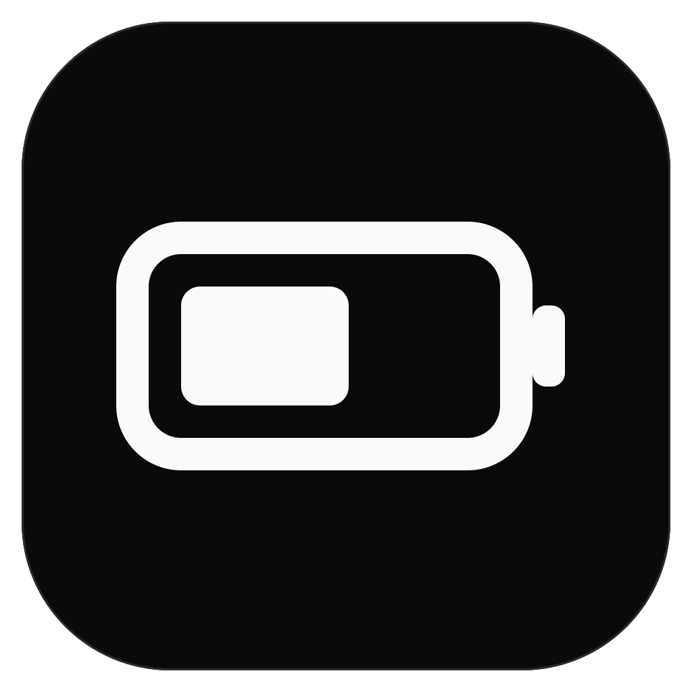
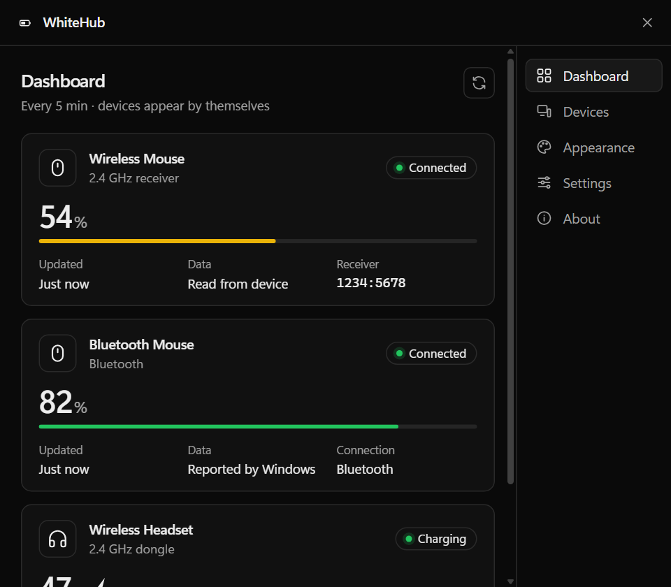
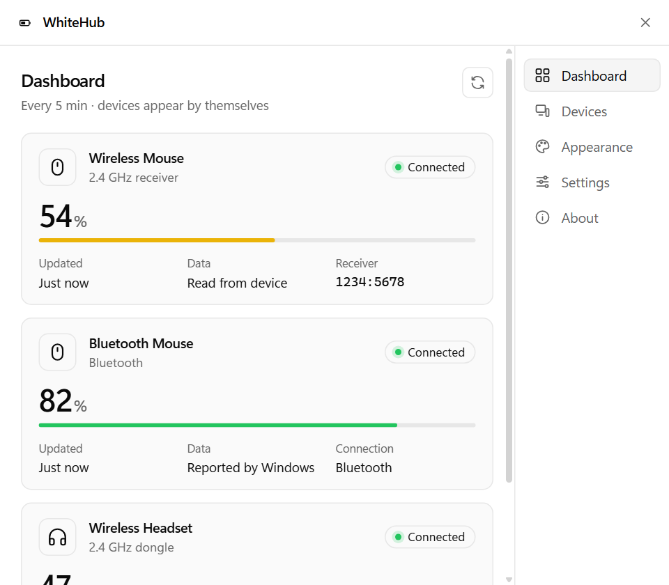
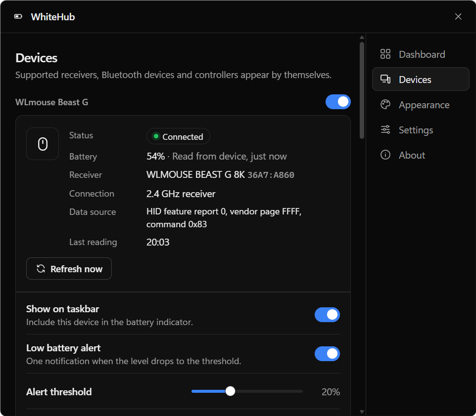
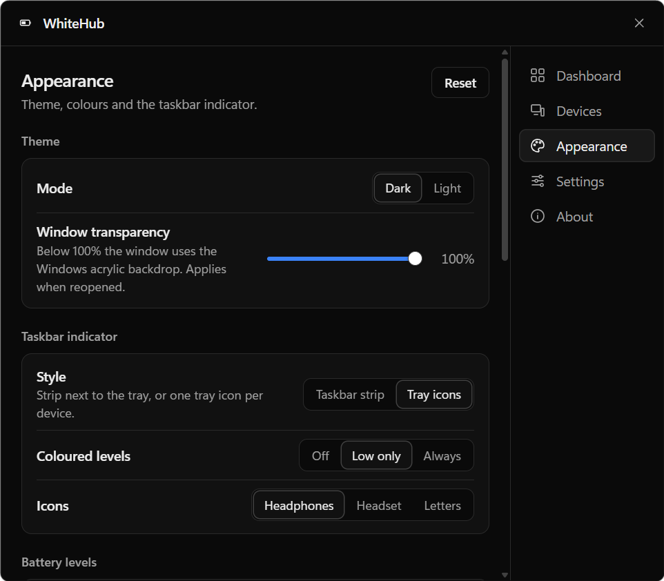

# WhiteHub

**Battery levels of your wireless gear, right on the Windows 11 taskbar.**

No vendor apps in the background. No drivers. No network access.

**English** | [Русский](README.ru.md)

### [Download for Windows](../../releases) · [What's new](CHANGELOG.md) · [Report an issue](../../issues/new/choose)

[Highlights](#highlights) · [Preview](#preview) · [Quick start](#quick-start) · [Devices](#devices) · [FAQ](#faq) · [Privacy](#privacy)

 

## Highlights

| Feature | What you get |
|---|---|
| **Found by itself** | Connect a supported device and it appears, with nothing to set up |
| **Always in sight** | Battery levels sit next to the clock, so you never have to open another app |
| **Charging status** | A bolt appears when a device is on its cable |
| **Timely alerts** | Low battery, connected and disconnected, with do not disturb |
| **Your look** | Dark and light themes, custom colours, three icon styles |
| **Lightweight** | One background process; the window is loaded only while it is open |
| **Private** | No telemetry, accounts or network requests |

## Preview

| Dashboard | Light theme |
|:---:|:---:|
|  |  |
| **Devices** | **Appearance** |
|  |  |

## Quick start

1. Download `WhiteHub_x.y.z_x64-setup.exe` from [Releases](../../releases).
2. Run it. It installs for your user only and needs no administrator rights.
3. Connect a [supported device](#devices). Its battery appears on the taskbar by itself.

> [!NOTE]
> The installer is not code-signed, so Windows SmartScreen may warn about an unknown publisher.

## Devices

| Device | Connection | Status |
|---|---|---|
| Any Bluetooth device whose battery Windows shows | Bluetooth | Tested with a mouse |
| WLmouse Beast G | 2.4 GHz `36A7:A860`, cable `36A7:A861` | Tested |
| HyperX Cloud III **S** Wireless | 2.4 GHz `03F0:06BE` | Tested |
| HyperX Cloud III S Wireless, other dongle | 2.4 GHz `03F0:02CC` | Untested |
| Xbox wireless controllers (battery steps) | XInput | Untested |
| Other WLmouse mice | Product ID entered by hand | Untested |

> [!IMPORTANT]
> Devices on their own 2.4 GHz dongle need support for that model, because every vendor uses its own protocol. Missing yours? Press **Devices → My device is missing → Create file** and [request it](../../issues/new?template=device-request.yml).

## FAQ

<b>Why does my mouse show an old value?</b>

A sleeping mouse does not report its battery. WhiteHub shows the last known value dimmed and tries again. Move the mouse and press **Refresh now**.

<b>Which Bluetooth devices work?</b>

Those whose level Windows itself shows in *Settings → Bluetooth & devices*. WhiteHub reads that number and sends nothing to the device. The Windows property is not officially documented.

<b>The WhiteHub tray icon is hidden. Where is it?</b>

Windows hides new icons under `^`. Turn it on in *Settings → Personalization → Taskbar → Other system tray icons*.

<b>Is the taskbar strip an official Windows feature?</b>

No. It is a small window placed inside the taskbar. If a Windows update breaks that, WhiteHub switches to tray icons.

<b>What has not been tested?</b>

Sleep and hibernation, several monitors, a light taskbar and an auto-hiding taskbar. Only the primary taskbar is used.

<b>How much memory does it use?</b>

About 7 MB of private memory in the background once the window has been used (measured with 0.1.7). While the window is open, WebView2 adds about 165 MB (measured with 0.1.0).

<b>How do I uninstall it?</b>

*Settings → Apps → WhiteHub*. The uninstaller asks whether to delete settings and logs.

## Privacy

WhiteHub sends only read-only battery queries, and only to the USB receivers listed above or to one you choose by its product ID. Bluetooth levels come from Windows. Settings live in `%APPDATA%\com.whitehub.desktop`, logs in `%LOCALAPPDATA%\com.whitehub.desktop`. Vulnerabilities: [SECURITY.md](SECURITY.md).

## For developers

Users only need the installer. Building from source and adding devices: [CONTRIBUTING.md](CONTRIBUTING.md). Device protocols: [docs/PROTOCOLS.md](docs/PROTOCOLS.md).

## Licence

[GPL-3.0](LICENSE), © 2026 whitemollie. Protocol sources and credits: [CREDITS.md](CREDITS.md).

WhiteHub is an independent project. It is not affiliated with or endorsed by WLmouse, HyperX or HP.
