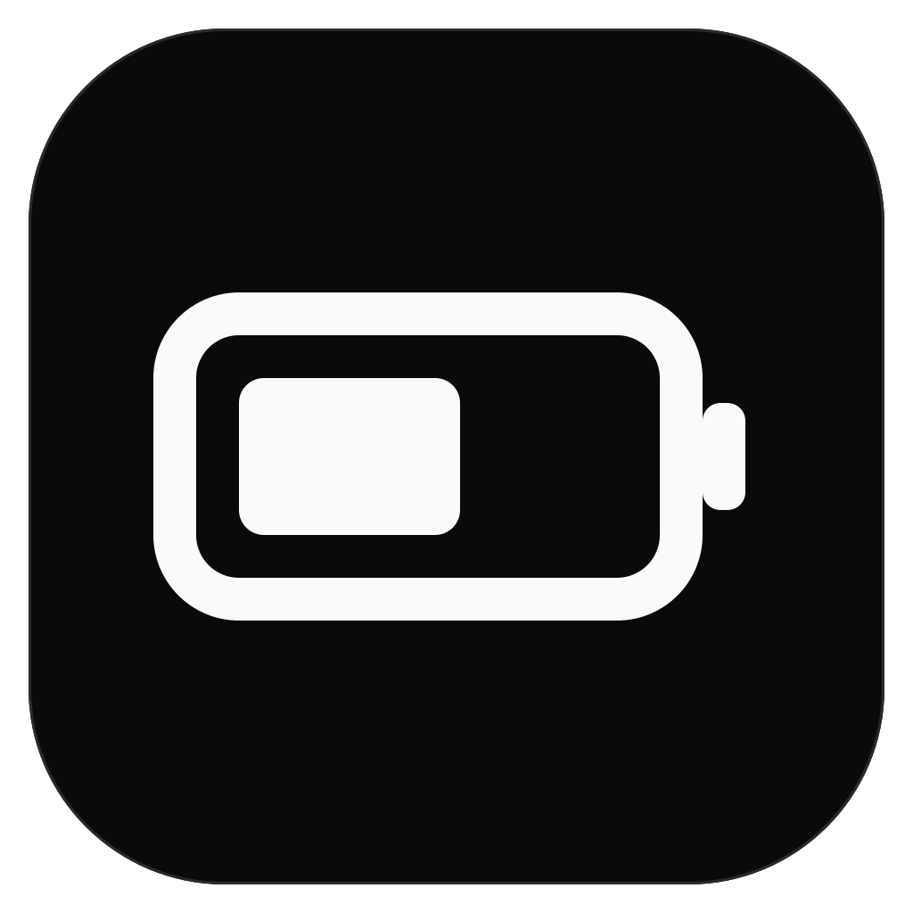
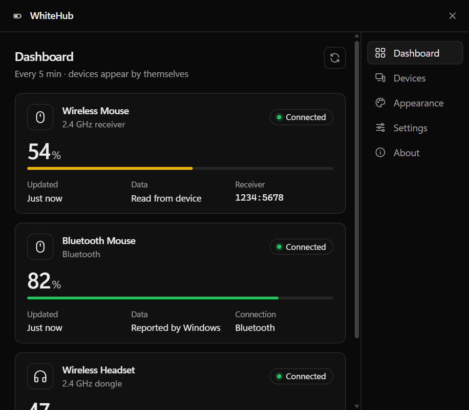
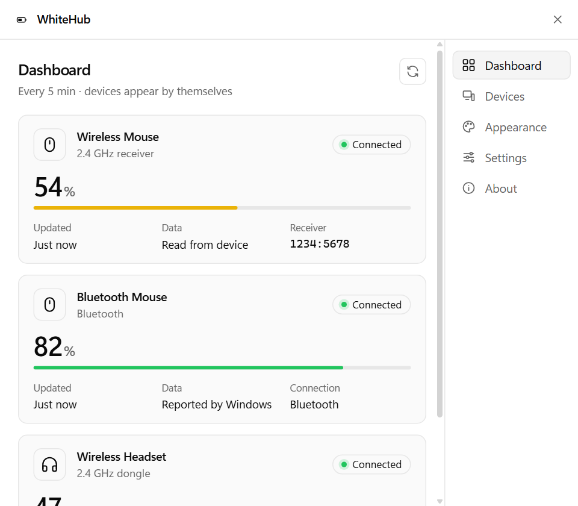
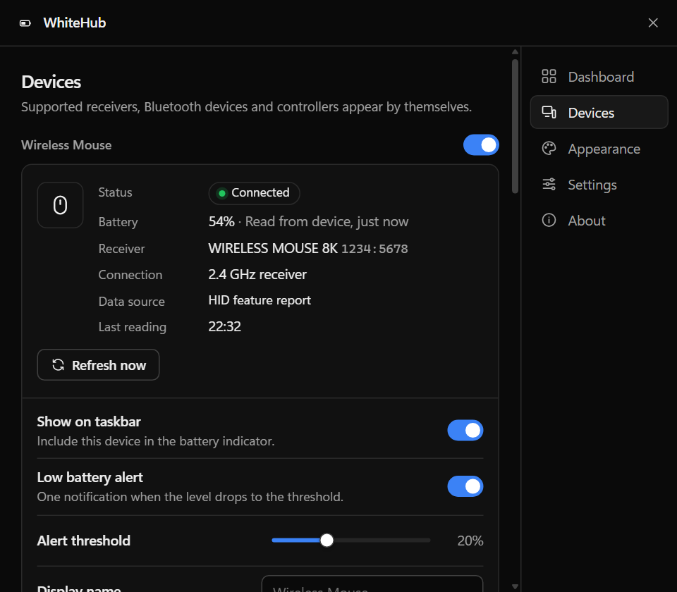
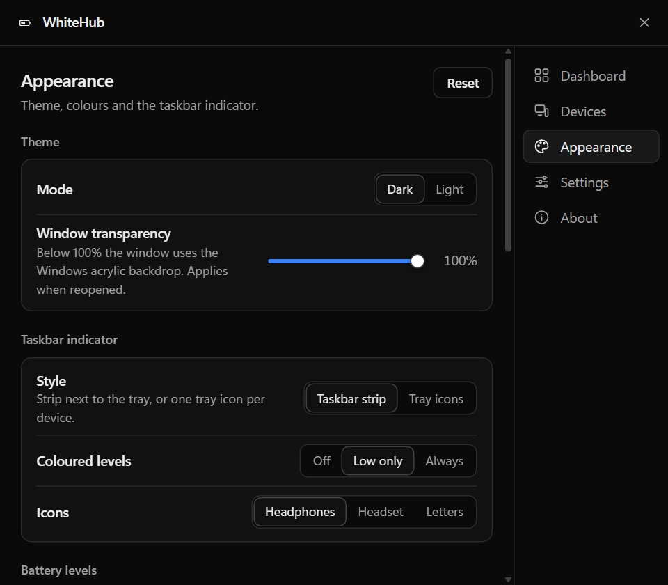

# WhiteHub

**Заряд беспроводных устройств прямо на панели задач Windows 11.**

Без фирменных программ в фоне. Без драйверов. Без доступа в сеть.

[English](README.md) | **Русский**

### [Скачать для Windows](../../releases) · [Что нового](CHANGELOG.md) · [Сообщить о проблеме](../../issues/new/choose)

[Возможности](#возможности) · [Как выглядит](#как-выглядит) · [Быстрый старт](#быстрый-старт) · [Как найти устройство](#как-найти-своё-устройство) · [Устройства](#устройства) · [Вопросы](#вопросы) · [Приватность](#приватность)

 

## Возможности

| Возможность | Что это даёт |
|---|---|
| **Находит само** | Подключите поддерживаемое устройство — оно появится, настраивать нечего |
| **Всегда на виду** | Заряд рядом с часами, другие программы открывать не нужно |
| **Зарядка** | Молния появляется, когда устройство подключено кабелем |
| **Уведомления** | Низкий заряд, подключение и отключение, режим «Не беспокоить» |
| **Оформление** | Тёмная и светлая темы, свои цвета, три вида значков |
| **Лёгкость** | Один фоновый процесс; окно загружается, только пока открыто |
| **Приватность** | Без телеметрии, аккаунтов и сетевых запросов |

## Как выглядит

| Главная | Светлая тема |
|:---:|:---:|
|  |  |
| **Устройства** | **Оформление** |
|  |  |

На снимках примеры устройств.

Интерфейс программы на английском.

## Быстрый старт

1. Скачайте `WhiteHub_x.y.z_x64-setup.exe` со страницы [Releases](../../releases).
2. Запустите. Установка идёт только для вашего пользователя, права администратора не нужны.
3. Подключите [поддерживаемое устройство](#устройства). Заряд сам появится на панели задач.

> [!NOTE]
> Установщик не подписан, поэтому Windows SmartScreen может предупредить о неизвестном издателе.

## Как найти своё устройство

Ничего искать и добавлять не нужно: WhiteHub ищет сам, при запуске и при каждом подключении.

| Ваше устройство | Что сделать |
|---|---|
| Bluetooth | Подключите его в Windows. Если заряд виден в *Параметры → Bluetooth и устройства*, его покажет и WhiteHub |
| Донгл 2.4 GHz поддерживаемой модели | Вставьте донгл и включите устройство |
| Донгл 2.4 GHz другой модели | Пока не поддерживается: нажмите **Devices → My device is missing → Create file** и [оставьте заявку](../../issues/new?template=device-request.yml) |
| Другая мышь поддерживаемого производителя | Введите её Product ID в **Devices → My device is missing** (не проверено) |
| Геймпад Xbox | Подключите его без провода и включите |

## Устройства

| Устройство | Подключение | Статус |
|---|---|---|
| Любое Bluetooth-устройство, чей заряд показывает Windows | Bluetooth | Проверено с мышью |
| WLmouse Beast G | 2.4 GHz `36A7:A860`, кабель `36A7:A861` | Проверено |
| HyperX Cloud III **S** Wireless | 2.4 GHz `03F0:06BE` | Проверено |
| HyperX Cloud III S Wireless, другой донгл | 2.4 GHz `03F0:02CC` | Не проверено |
| Беспроводные геймпады Xbox (заряд ступенями) | XInput | Не проверено |
| Другие мыши WLmouse | Product ID вручную | Не проверено |

> [!IMPORTANT]
> Устройствам с собственным донглом 2.4 GHz нужна поддержка именно их модели: у каждого производителя свой протокол.

## Вопросы

<b>Почему у мыши старое значение?</b>

Спящая мышь не отдаёт заряд. WhiteHub показывает последнее известное значение приглушённо и повторяет запрос. Подвигайте мышью и нажмите **Refresh now**.

<b>Какие Bluetooth-устройства работают?</b>

Те, чей заряд сама Windows показывает в *Параметры → Bluetooth и устройства*. WhiteHub читает это число и ничего не отправляет устройству. Это свойство Windows официально не документировано.

<b>Где иконка WhiteHub в трее?</b>

Windows прячет новые иконки под `^`. Включите её: *Параметры → Персонализация → Панель задач → Другие значки в системном трее*.

<b>Полоска — официальная возможность Windows?</b>

Нет. Это небольшое окно внутри панели задач. Если обновление Windows это сломает, WhiteHub перейдёт на иконки в трее.

<b>Что не проверялось?</b>

Сон и гибернация, несколько мониторов, светлая и автоскрываемая панель задач. Используется только основная панель.

<b>Сколько памяти занимает?</b>

Около 7 МБ собственной памяти в фоне после открытия окна (замер на 0.1.7). Пока окно открыто, WebView2 добавляет около 165 МБ (замер на 0.1.0).

<b>Как удалить?</b>

*Параметры → Приложения → WhiteHub*. Деинсталлятор спросит, удалять ли настройки и логи.

## Приватность

WhiteHub отправляет только запросы на чтение заряда, и только перечисленным выше USB-приёмникам или тому, который вы сами указали по Product ID. Заряд Bluetooth-устройств берётся у Windows. Настройки лежат в `%APPDATA%\com.whitehub.desktop`, логи — в `%LOCALAPPDATA%\com.whitehub.desktop`. Об уязвимостях: [SECURITY.md](SECURITY.md).

## Для разработчиков

Обычному пользователю нужен только установщик. Сборка и добавление устройств: [CONTRIBUTING.md](CONTRIBUTING.md). Протоколы: [docs/PROTOCOLS.md](docs/PROTOCOLS.md).

## Лицензия

[GPL-3.0](LICENSE), © 2026 whitemollie. Источники протоколов и благодарности: [CREDITS.md](CREDITS.md).

WhiteHub — независимый проект, не связанный с производителями устройств.
