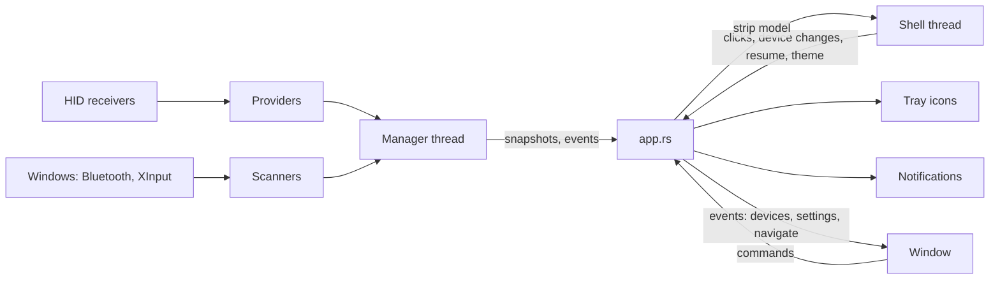

# Architecture

How WhiteHub 0.2.2 is built. Reasons: [DECISIONS.md](DECISIONS.md). Device protocols: [PROTOCOLS.md](PROTOCOLS.md). Current status: [PROJECT_STATE.md](PROJECT_STATE.md).

One Windows process in Rust (Tauri 2). The user interface (SolidJS, TypeScript, Vite) runs in WebView2, which exists only while the window is open.

## Threads

| Thread | Work |
|---|---|
| Main | Tauri event loop, window, tray icons |
| `battery-manager` | All battery queries: owns the HID API, providers and scanners; sleeps until a poll is due or a command arrives |
| `<device>-events` | Blocks on one device's input reports and asks the manager for a poll |
| `shell` | Taskbar strip and Windows broadcasts; draws only, because its input queue is attached to Explorer's |
| Short-lived | Window fades, memory trimming |

## Backend: `src-tauri/src`

| File | Responsibility |
|---|---|
| `app.rs` | Start, shutdown, wiring; applies settings; remembers and forgets devices |
| `battery/mod.rs` | Shared types: `DeviceSnapshot`, `DeviceKind`, `Status`, `Level` |
| `battery/manager.rs` | Scheduling, retries, snapshots, connect and low battery events |
| `battery/provider.rs` | `Provider` trait: one specific HID device |
| `battery/wlmouse.rs`, `hyperx.rs` | The two providers |
| `battery/scanner.rs` | `Scanner` trait: finds any number of devices |
| `battery/bluetooth.rs`, `xinput.rs` | The two scanners |
| `battery/report.rs` | Text of a device request |
| `indicators.rs` | Turns snapshots into strip items and tray levels |
| `shell/mod.rs` | Strip window, embedding, tooltips, Windows messages |
| `shell/render.rs` | Draws the strip, the device tray icons and the logo in the tray |
| `tray.rs` | Notification-area icons |
| `window.rs` | Window: creation, placement, reveal, fade, destruction |
| `commands.rs` | Everything the window may call |
| `settings.rs` | Defaults, validation, loading and saving |
| `notifications.rs`, `logging.rs`, `autostart.rs`, `system.rs` | Toasts, log file, Run key, Windows facts |

## Battery data

- **Providers** are polled when due; `poll` must finish within about 2 seconds. A poll is also triggered by a changed USB signature, a device event, the user, or opening the window (data older than 60 s).
- **Scanners** run together at every interval, after device changes and when the window opens. A device is added once it is connected and shows a level.
- The interval is 5, 10, 15, 30 or 60 minutes. A device that does not answer is retried after 30, 60, 120, 300 and 600 s, never later than the interval.
- After resume from sleep the HID API is recreated and everything is read again 5 s later.
- A panic in a provider or scanner is caught and does not stop the manager.
- At most 64 devices are kept. Low battery alerts re-arm 5 points above the threshold.

| ID | Source |
|---|---|
| `wlmouse`, `hyperx` | Fixed providers |
| `bt:<container guid>` | Bluetooth scanner |
| `xinput:<n>` | Controller slot |

| Status | Meaning |
|---|---|
| `Unknown` | Not polled yet |
| `Online` | Level was read |
| `Asleep` | Receiver present, no answer; for discovered devices: connected, no level |
| `Off` | Device is switched off or out of range |
| `Disconnected` | Receiver or device is absent |
| `Error` | Query failed |
| `Disabled` | Switched off by the user |

Fixed devices keep their last value in the indicators; discovered ones disappear while away.

## Taskbar strip

A layered child window of `Shell_TrayWnd`, left of `TrayNotifyWnd`, filled with `UpdateLayeredWindow`. It follows the notification area through a WinEvent hook and redraws on theme, resolution and DPI changes. Embedding is tried up to 15 times, 2 s apart, and again after Explorer restarts (`TaskbarCreated`). If it fails, or if the user prefers it, tray icons per device are shown instead.

A hidden top-level window on the same thread receives the broadcasts for device changes and resume.

## Window

One window, 640×560 (lower on small screens), above the notification area of the monitor under the cursor. It is created cloaked, revealed when the page calls `window_ready` (or after 2.5 s), and destroyed on close. Below 100 % opacity it uses the acrylic backdrop and does not fade. The process keeps running until Quit.

## Frontend: `src`

| Path | Responsibility |
|---|---|
| `app/api.ts` | Types, commands and events |
| `app/store.ts` | State; saves settings with a short delay |
| `app/format.ts`, `app/theme.ts` | Texts, defaults, CSS variables |
| `pages/*` | Dashboard, Devices, Appearance, Settings, About |
| `components/*` | Sidebar, device card, controls, icons |

The interface never touches devices. Commands: `get_state`, `update_settings`, `default_settings`, `refresh`, `window_ready`, `close_window`, `forget_device`, `export_device_request`, `export_diagnostics`, `open_logs_folder`, `quit`. Window permissions: events and dragging only (`capabilities/default.json`).

## Data on disk

| Data | Place |
|---|---|
| `settings.json` (version 2) | Tauri's configuration folder for `com.whitehub.desktop` |
| Log, rotated once at 512 KiB | Tauri's log folder |
| Diagnostics, device requests | Desktop, only when the user asks |
| Autostart | `HKCU` Run key; removed by a real uninstall, kept across updates (`windows/hooks.nsh`) |

Arguments: `--autostart` starts without the window; `--page <name>` opens a page. A second start opens the window of the running copy.

## Build

Commands: [CONTRIBUTING.md](../CONTRIBUTING.md). Bundle: NSIS for the current user. CI (`.github/workflows/ci.yml`) runs the npm audit, frontend build, clippy and tests on Windows.
